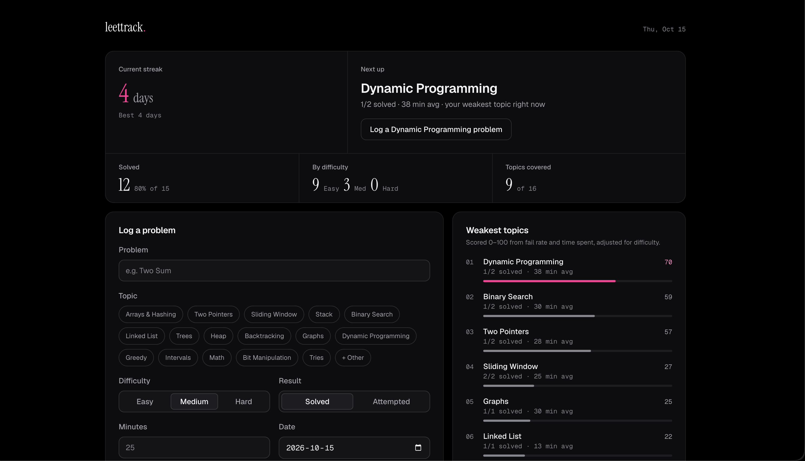
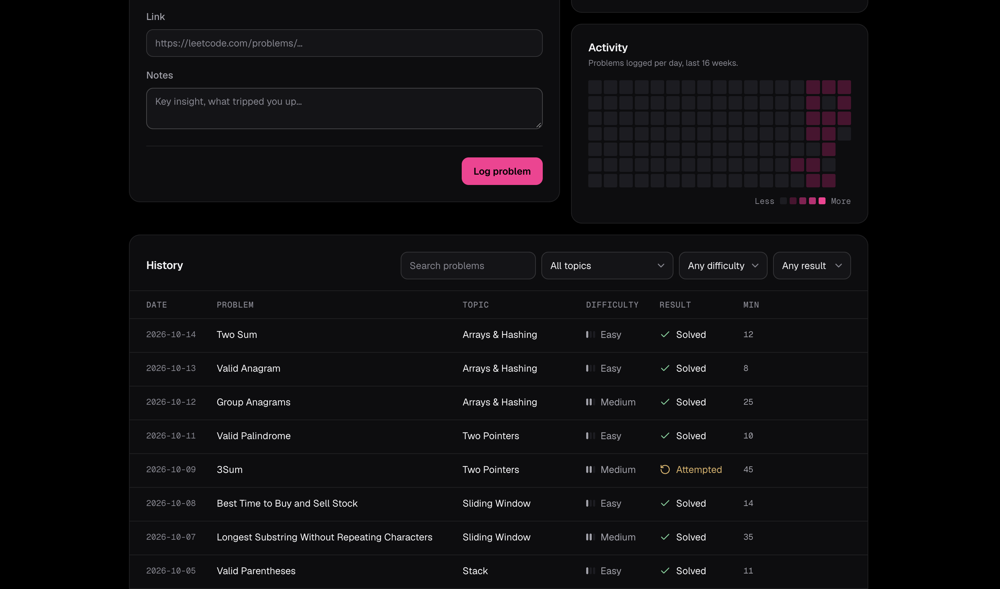

<div align="center">

# ⋆˚✿˖° leettrack. °˖✿˚⋆

*my little LeetCode / OA practice tracker* ♡

[**✧ live demo ✧**](https://leettrack-k8v3.onrender.com/)

</div>

<br>

I built this to track my LeetCode and OA practice ₊˚⊹ I log every problem I do (topic, difficulty, time, and whether I actually solved it), and it tells me which topics I'm weakest at so I know what to work on next. It also tracks my streak, because keeping it alive is half the motivation ᯓ★





## ୨୧ what it does

- **⋆ streak:** consecutive days with at least one problem logged (it doesn't reset at midnight before I've practiced)
- **⋆ next up:** my weakest topic right now, with a button to log a problem in it
- **⋆ weakest topics:** every topic scored 0–100, so I know where to focus
- **⋆ activity heatmap:** the last 16 weeks, in five shades of pink
- **⋆ history:** every problem I've logged, searchable and filterable by topic, difficulty and result

## ⊹ stack

React + Vite · Node/Express · SQLite (`node:sqlite`) · tested with `node:test`

## ₊˚ running it

Needs Node 22.5+.

```bash
npm install
npm run seed   # optional sample data
npm run dev
```

Then open http://localhost:5173 ♡ Run `npm test` for the tests.

## ✿ how the weakness score works

For each topic, I combine how often I fail it with how long it takes me, adjusted for difficulty (a slow Hard shouldn't count the same as a slow Easy):

```
weakness = 0.6 × fail rate + 0.4 × (avg minutes / difficulty weight, scaled to the slowest topic)
```

Difficulty weights are Easy 1, Medium 2, Hard 3. The logic is in [`server/stats.js`](server/stats.js).

## ⋆ api

| Method | Endpoint            | Description                                  |
| ------ | ------------------- | -------------------------------------------- |
| GET    | `/api/problems`     | List problems (filters: `q`, `topic`, `difficulty`, `status`) |
| POST   | `/api/problems`     | Add a problem                                |
| PUT    | `/api/problems/:id` | Update a problem                             |
| DELETE | `/api/problems/:id` | Delete a problem                             |
| GET    | `/api/stats`        | Totals, streaks, per-topic breakdown         |
| GET    | `/api/topics`       | Every topic I've logged                      |

<br>

<div align="center">

*made with ♡ and way too many sliding window problems* ⋆˚࿔

</div>
